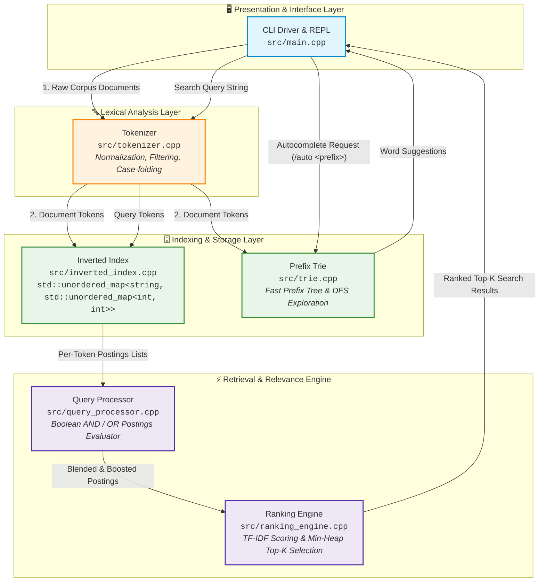
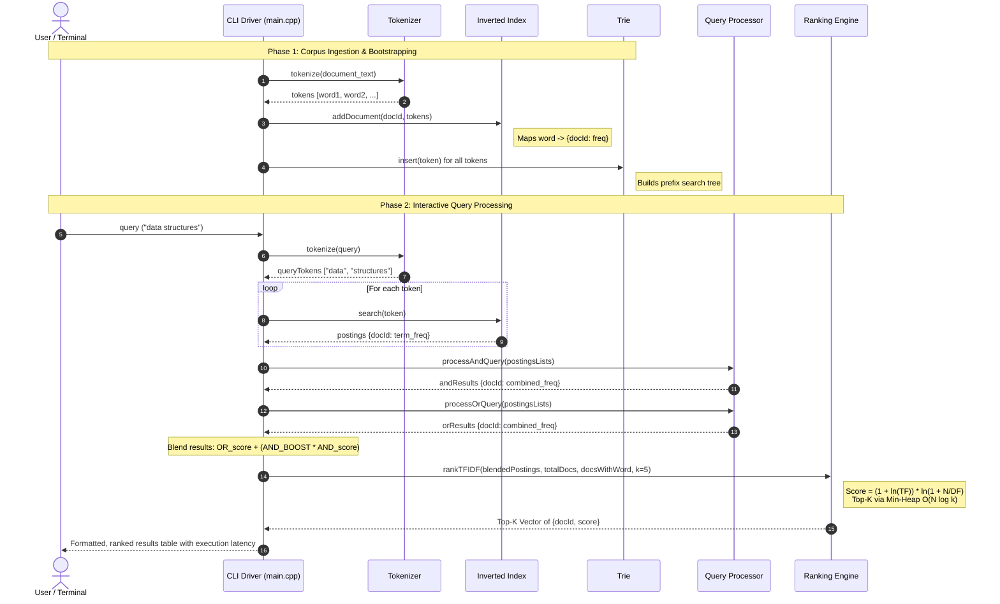
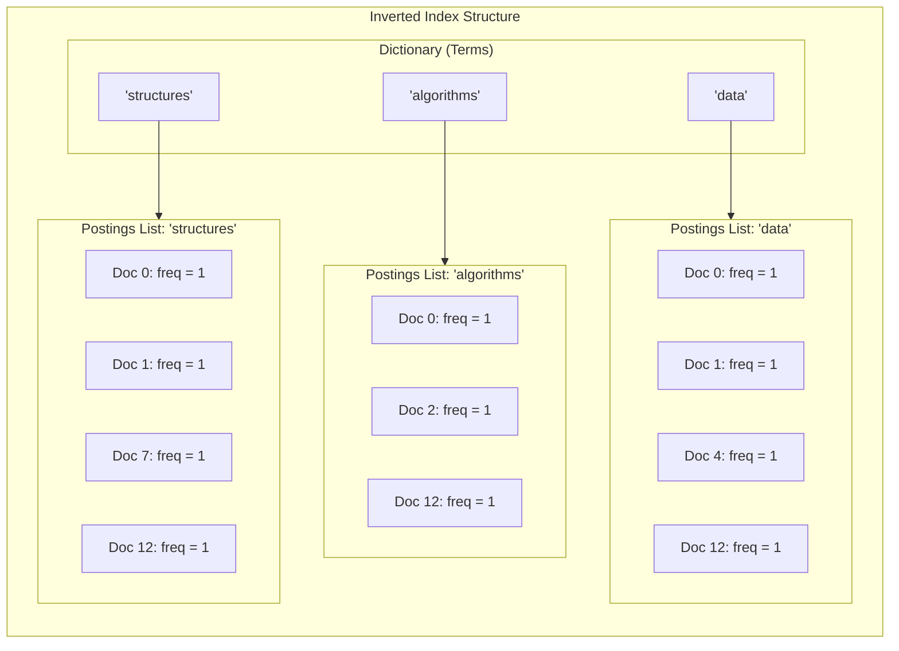
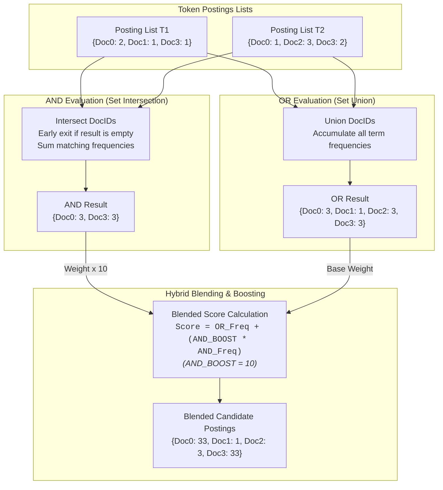
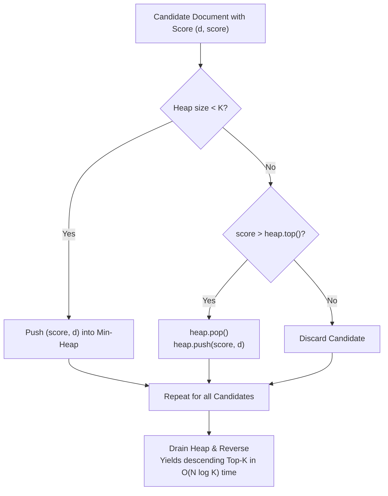
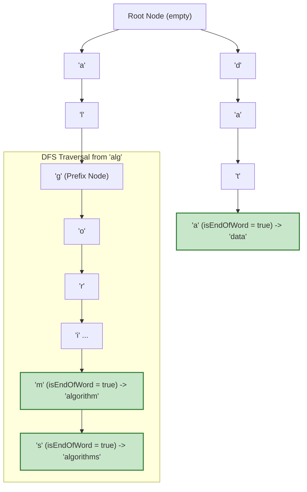

# 🔍 Indexra

### High-Performance Search Engine Core Built from Scratch in C++23

[](https://en.cppreference.com/w/cpp/23)
[](https://cmake.org/)
[](https://opensource.org/licenses/MIT)
[](#-system-architecture)

**Indexra** is a high-performance, from-scratch search engine core written in modern **C++23**. It demonstrates the fundamental mechanics that power production search engines and information retrieval systems—including **lexical tokenization**, **inverted index construction**, **boolean query resolution (AND/OR)**, **hybrid TF-IDF relevance ranking**, and **trie-based autocomplete**—all accessible via an interactive, colored terminal interface.

---

## 📑 Table of Contents

- [System Architecture](#-system-architecture)
- [System Lifecycle & Data Flow](#-system-lifecycle--data-flow)
- [How It Works: Component Deep-Dive](#-how-it-works-component-deep-dive)
  - [1. Tokenization & Normalization](#1-tokenization--normalization)
  - [2. Inverted Index Construction](#2-inverted-index-construction)
  - [3. Boolean Query Processor](#3-boolean-query-processor)
  - [4. TF-IDF Ranking Engine & Top-K Selection](#4-tf-idf-ranking-engine--top-k-selection)
  - [5. Trie Autocomplete](#5-trie-autocomplete)
- [Algorithmic Complexity](#-algorithmic-complexity)
- [Project Structure](#-project-structure)
- [CLI Walkthrough & Sample Output](#-cli-walkthrough--sample-output)
- [Build & Run](#-build--run)
- [Future Enhancements](#-future-enhancements)

---

## 🏗 System Architecture

Indexra is organized around decoupled modules where each component fulfills a distinct responsibility within the Information Retrieval (IR) pipeline.



---

## 🔄 System Lifecycle & Data Flow

Indexra operates in two discrete phases: **Ingestion & Indexing Time** and **Query & Retrieval Time**.



---

## ⚙️ How It Works: Component Deep-Dive

### 1. Tokenization & Normalization

The `Tokenizer` converts unstructured raw strings into normalized, indexable tokens:
- **Filtering:** Strips punctuation, control characters, and whitespace using `std::isalnum`.
- **Case-Folding:** Converts characters to lowercase with `std::tolower` for case-insensitive matching.
- **Pipeline Consistency:** Identical logic is shared across corpus indexing and user query evaluation to guarantee index alignment.

```
"Dynamic Programming is a powerful ALGorithmic technique!"
  │
  ▼ (Alphanumeric filter + std::tolower)
["dynamic", "programming", "is", "a", "powerful", "algorithmic", "technique"]
```

---

### 2. Inverted Index Construction

The `InvertedIndex` provides $O(1)$ average-time lookup for postings lists using a hash-map-of-hash-maps design:

$$\text{index}: \text{std::string} \longrightarrow \Big( \text{docId} \longrightarrow \text{frequency} \Big)$$

- Each unique term points to a map of document IDs and the term frequency within that document.
- Term frequencies serve as the foundational weight for downstream TF-IDF scoring.
- Average retrieval for a single keyword postings list is $O(1)$.



---

### 3. Boolean Query Processor

Search queries frequently contain multiple terms. The `QueryProcessor` resolves boolean relationships between postings lists:



- **AND Queries:** Computes the set intersection across all query term postings lists. If any term has zero matches or the intermediate intersection becomes empty, evaluation terminates early.
- **OR Queries:** Computes the set union, aggregating term occurrences across documents to ensure maximum recall.
- **Hybrid Blending with Priority Boosting:** Documents that satisfy all terms (AND match) receive a **10x boost** over documents containing only partial terms (OR matches):

$$\text{BlendedScore}(d) = \text{Freq}_{\text{OR}}(d) + \Big( 10 \times \text{Freq}_{\text{AND}}(d) \Big)$$

---

### 4. TF-IDF Ranking Engine & Top-K Selection

Documents matching query terms are ranked using a combination of **Term Frequency (TF)**, **Inverse Document Frequency (IDF)**, and **Heap-based selection**.

#### Mathematical Formulation

1. **Log-Normalized Term Frequency:**
   Diminishes the dominance of repetitive keywords within long documents:

   $$\text{TF}(t, d) = 1.0 + \ln(\text{rawTF}(t, d))$$

2. **Smoothed Inverse Document Frequency:**
   Penalizes words that appear across all documents while rewarding discriminative terms:

   $$\text{IDF}(t, D) = \ln\left(1.0 + \frac{N}{|d \in D : t \in d|}\right)$$

   Where $N$ is the total corpus size and $|d \in D : t \in d|$ is the document frequency ($DF$).

3. **Composite Document Score:**

   $$\text{Score}(d) = \text{TF}(t, d) \times \text{IDF}(t, D)$$

#### Min-Heap Top-K Selection

Instead of performing a full $O(N \log N)$ sort on the entire document space, the ranking engine maintains a **Min-Heap of size $K$** (`std::priority_queue` with `std::greater`):



---

### 5. Trie Autocomplete

The `Trie` module provides real-time search suggestions with prefix matching:



- **Prefix Locating:** Advances down the character tree in $O(L)$ time, where $L$ is the prefix length.
- **Subtree Exploration (DFS):** Recursively traverses all child branches to gather matching suffixes in $O(M)$ time, where $M$ is the number of nodes in the prefix subtree.
- **Fast Exit:** Immediately returns an empty result set if any character in the prefix does not exist in the trie.

---

## 📊 Algorithmic Complexity

| Component | Operation | Time Complexity | Space Complexity |
| :--- | :--- | :--- | :--- |
| **Tokenizer** | Text tokenization | $O(L)$ where $L$ = string length | $O(T)$ where $T$ = token count |
| **Inverted Index** | Add document | $O(T)$ where $T$ = tokens in document | $O(V \times D)$ unique terms & postings |
| **Inverted Index** | Term lookup | $O(1)$ average | $O(P)$ where $P$ = postings list size |
| **Query Processor** | AND Intersection | $O(\min(P_1, P_2, \dots))$ with early exit | $O(\min(P_1, P_2, \dots))$ |
| **Query Processor** | OR Union | $O(\sum P_i)$ over all term postings | $O(\sum P_i)$ unique matching docs |
| **Ranking Engine** | Top-K Selection | $O(N \log K)$ ($N$ candidates, heap size $K$) | $O(K)$ heap space |
| **Trie** | Word insertion | $O(W)$ where $W$ = word length | $O(W \times |\Sigma|)$ |
| **Trie** | Prefix Autocomplete | $O(L + M)$ ($L$ = prefix len, $M$ = subtree nodes) | $O(S)$ where $S$ = suggestions size |

---

## 📁 Project Structure

```
Indexra/
├── CMakeLists.txt              # CMake build configuration (C++23)
├── .gitignore                  # Git ignore rules for build artifacts
├── README.md                   # Project documentation and architecture guide
└── src/
    ├── main.cpp                # Interactive REPL CLI and system pipeline orchestrator
    ├── tokenizer.h / .cpp      # String parsing, punctuation filtering & case normalization
    ├── inverted_index.h / .cpp # Postings list management and document mapping
    ├── query_processor.h / .cpp# Boolean logic evaluator (AND intersection & OR union)
    ├── ranking_engine.h / .cpp # TF-IDF calculation and Min-Heap Top-K ranking
    └── trie.h / .cpp           # Prefix tree data structure for autocomplete
```

---

## 🖥️ CLI Walkthrough & Sample Output

### Booting & Ingestion
```text
[SYSTEM] Booting Indexra and ingesting corpus...
[OK] Indexed 15 documents in 1.42 ms

  ___           _
 |_ _|_ __   __| | _____  ___ __ __ _
  | || '_ \ / _` |/ _ \ \/ / '__/ _` |
  | || | | | (_| |  __/>  <| | | (_| |
 |___|_| |_|\__,_|\___/_/\_\_|  \__,_|

 High-Performance Search Engine Core (C++23)
 Type your query, or type '/exit' to quit.
 Type '/auto <prefix>' for autocomplete demo.
==================================================
```

### Search Query Execution
```text
indexra> data structures

 [5 results found in 18.4 µs]
------------------------------------------------------------
  Rank DocID       Score  Snippet
------------------------------------------------------------
     1     0     32.7831  Data Structures and Algorithms form the core o...
     2    12     32.7831  algorithms and data structures are essential f...
     3     1     32.7831  advanced data structures like Segment trees an...
     4     7     32.7831  binary search trees heaps and tries are fundam...
     5     4     16.3916  competitive programming requires strong data s...
```

### Prefix Autocomplete
```text
indexra> /auto alg
 Autocomplete for 'alg':
   - algorithmic
   - algorithm
   - algorithms

indexra> /auto dat
 Autocomplete for 'dat':
   - data
```

---

## ▶️ Build & Run

### Prerequisites
- **Compiler:** Any modern C++23 compliant compiler (e.g. GCC 13+, Clang 16+, or MSVC 2022 v19.34+)
- **Build System:** CMake 3.10+ (optional, direct g++ compilation also supported)

### Option 1: Build with CMake (Recommended)

```bash
# Generate build files
cmake -B build -DCMAKE_BUILD_TYPE=Release

# Build the executable
cmake --build build --config Release

# Run Indexra
./build/indexra          # On Linux / macOS
./build/Release/indexra  # On Windows (MSVC)
```

### Option 2: Direct Compilation with g++

```bash
cd src
g++ -std=c++23 -O3 -Wall -Wextra main.cpp tokenizer.cpp inverted_index.cpp \
    query_processor.cpp ranking_engine.cpp trie.cpp -o indexra

# Execute
./indexra
```

---

## 🚀 Future Enhancements

- [ ] **BM25 Relevance Scoring:** Implement Okapi BM25 ranking with document length normalization ($k_1$, $b$ parameters).
- [ ] **Positional Indexing:** Track term positions within documents to enable exact phrase queries (`"quick brown fox"`) and proximity searching.
- [ ] **Persistence Layer:** Serialize and deserialize inverted index and trie structures to disk using memory-mapped files or protocol buffers.
- [ ] **Fuzzy Search:** Integrate Levenshtein Automaton with the Trie to support spell-checking and typo tolerance.
- [ ] **Multi-threaded Ingestion:** Implement chunk-based parallel indexing using a producer-consumer thread pool.

---

## 📄 License

This project is licensed under the [MIT License](LICENSE).
